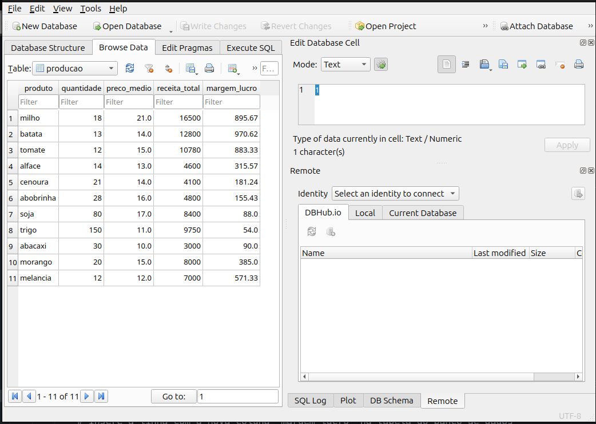

# Food Production ETL Pipeline (`dsa_demo4`) 🌾


> **TL;DR:** An incremental Python ETL pipeline (`v1` to `v5`) using only standard libraries (`csv` and `sqlite3`) to extract raw food production data (`producao_alimentos.csv`), filter low-volume records (`quantidade > 10`), normalize revenue strings into integers, and enrich the dataset with rounded profit margins (`margem_lucro`) inside a SQLite database (`dsadb.db`).

---

## 📋 Context & Stack

Raw CSV exports often require progressive business rules before reaching an analytical database. This project demonstrates a step-by-step ETL evolution without external dependencies:

* **Language:** Python 3.9.13 (managed via Conda)
* **Standard Libraries:** `csv` (extraction) and `sqlite3` (DDL/DML operations)
* **Database & Inspection:** SQLite (`dsadb.db`) verified with DB Browser for SQLite

---

## 🔄 Pipeline Progression

| Version | File | Transformation / Business Rule |
| :--- | :--- | :--- |
| **v1** | `job_v1.py` | Creates `dsadb.db` and `producao` table, loading all 15 raw rows from `producao_alimentos.csv`. |
| **v2** | `job_v2.py` | Resets the table on execution (`DROP TABLE IF EXISTS`) and filters records to keep only `quantidade > 10` (11 rows). |
| **v3** | `job_v3.py` | Strips thousand-separator dots from `receita_total` and casts the column to `INTEGER`. |
| **v4** | `job_v4.py` | Adds the `margem_lucro` (`REAL`) column to compute gross profit margin per unit sold. |
| **v5** | `job_v5.py` | Rounds `margem_lucro` to two decimal places and standardizes numeric casting. |

---

## 📊 Output Preview (`job_v5.py`)

Final `producao` table inspected in **DB Browser for SQLite** after running `job_v5.py`:

<p align="center">
  
</p>

---

## 🚀 Getting Started

1. **Create and activate the Conda environment:**
   ```bash
   conda create -n dsa_demo4 python=3.9.13 -y
   conda activate dsa_demo4